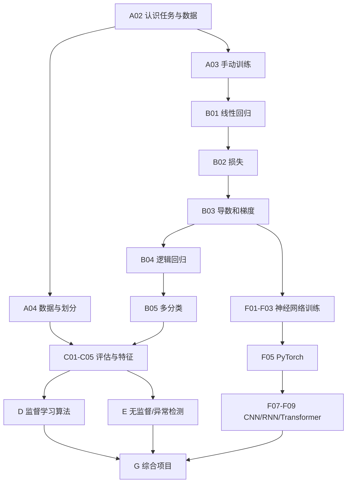

# 机器学习与深度学习基础 · 课程架构 v2.0

> 状态：课程结构基线。仅在 `refactor/ml-curriculum-v2` 开发；任何新章节上线必须同步导航、维护映射、测试与证据。2026-11-09。
>
> 依据：现有「机器学习与深度学习基础」33 个阅读单元（含附录）、`nowcoder-ai-question-bank/jsonl/机器学习基础.jsonl` 497 道（383 单选、114 多选；按原文件逐题统计）。题库只是缺口线索，不是事实真值或教学顺序。

## 教学目标与边界

面向数学基础不扎实、初学机器学习的读者，建立“观察现象 → 分清问题 → 理解机制 → 定义变量 → 推导/交代假设 → 数字逐步代入 → 可重复运行 → 诊断与迁移”的连续学习体验。以**理解与独立复现**而非新增页数为验收目标。

A、B、C 是所有路线的公共基础；D（传统监督学习）、E（无监督）、F（深度学习）按目标分支；G 是项目；X 属于可跳过的专题。核心主线不得依赖 X 或其他板块中的高级推导。

同一知识点只指定一个“权威讲解”；其他页面短回顾 + 明确链接。现存「机器学习的数学原理」「数据这一关」「PyTorch这个框架本身」「Kaggle竞赛方法论」「模型上线之后」「推荐算法」「强化学习基础」都维持独立边界。

## 正式文章目录（展示编号，不是当前 HTML 文件名）

### A 从零认识机器学习 · 核心
- A00 如何使用这套教程（现 00）
- A01 十分钟训练第一个模型：只体验输入/输出/指标（现 01）
- A02 机器学习到底在做什么：任务、样本、标签、泛化（现 02）
- A03 手动训练模型：预测→误差→调整（现 02a）
- A04 数据、特征、标签与数据划分（新增；在预测时刻可获取信息、训练/验证/测试）

### B 从回归到分类 · 核心 B01–B05，进阶 B06–B08
- B01 线性回归：一个特征到多个特征（现 03）
- B02 损失函数：残差→MSE/MAE/Huber（现 03b）
- B03 梯度下降：变化率→偏导→链式法则→更新（新增；从现 02a、03a、03b 提炼，不删除已有可视化）
- B04 逻辑回归：分数→Sigmoid→二分类交叉熵（现 03a）
- B05 多分类：Softmax、多分类交叉熵、OvR/OvO（新增）
- B06 线性回归的统计假设与诊断：OLS、共线性、异方差、自相关（新增，进阶；区分预测和统计推断）
- B07 回归输出层与目标范围（现 03c，进阶）
- B08 概率回归与广义线性模型：Gaussian、Poisson、连接函数（现 03d 扩展，进阶）

### C 评估、泛化与数据 · 核心 C01–C05，进阶 C06
- C01 回归与分类指标：混淆矩阵、Precision/Recall/F1、ROC/PR、MAE/RMSE/R²（现 05 拆分）
- C02 过拟合、欠拟合与偏差方差（现 05 拆分）
- C03 正则化：L1/L2 与模型复杂度（现 05a）
- C04 交叉验证、数据泄漏与模型选择（现 05 拆分）
- C05 特征工程与 sklearn Pipeline（现 16 前移）
- C06 概率校准与决策阈值（新增，进阶）

### D 经典监督学习 · D01–D05 核心，D06–D07 进阶
- D01 KNN：邻居投票、距离和缩放（新增）
- D02 朴素贝叶斯：先验、后验、条件独立与平滑（新增）
- D03 决策树：划分、熵、基尼与剪枝（现 04）
- D04 随机森林与 Bagging（现 04a 拆分）
- D05 AdaBoost、Boosting 与 GBDT（现 04a 拆分）
- D06 XGBoost、LightGBM、CatBoost：机制与二阶推导分层（现 04b，进阶）
- D07 SVM：最大间隔、软间隔与核技巧（现 05b，进阶）

### E 无监督与异常检测
- E01 无监督任务与 K-Means（现 06 拆分，核心）
- E02 DBSCAN、层次聚类及簇形状（新增，核心）
- E03 PCA、SVD 与降维（现 06 拆分，核心；严密推导链接数学原理）
- E04 GMM 与 EM：软分配、局部最优（链接数学原理 13，进阶）
- E05 LOF、Isolation Forest 与异常检测（新增，进阶）

### F 深度学习
- F01 线性模型的局限→MLP 和激活函数（现 07）
- F02 前向传播、计算图与反向传播（现 08）
- F03 优化器、学习率与批次（现 09）
- F04 正则化、归一化与训练稳定性（现 10，拆清不同机制）
- F05 PyTorch：一次完整且可复现的训练（现 15，前移）
- F06 训练故障诊断（现 11）
- F07 CNN：卷积、参数共享与感受野（现 12）
- F08 RNN/LSTM 与序列建模（现 13）
- F09 Attention 与 Transformer（现 14）

### G 实战
- G01 表格预测：从数据到可信评估（现 17 的项目一）
- G02 同数据的四种解法公平比较（现 19）
- G03 过拟合实验室（现 20）
- G04 手写神经网络与图像迁移（现 17 项目二/三）
- G05 手写 mini-torch（现 18，挑战）

### X 进阶专题（不得阻塞主线）
- X01 时间序列预测与时间验证（新增）
- X02 AR/MA/ARIMA/GARCH（新增）
- X03 HMM/CRF 经典概率序列模型（新增或链接经典 NLP）
- X04 半监督与自监督（新增）
- X05 在线/增量学习与 FTRL（新增）
- X06 联邦学习、FedAvg/FedProx、Non-IID（新增）

附录：现 A 术语、B 代码、C 手写算法保留。

## 主干知识依赖

实际页面导航中，现 03b 必须显示在现 03a 之前；评估和特征工程提前；PyTorch 在架构前。仅显示排序改变时，不得把“尚未新增的文章”标为已上线。

## 教学、视觉与验收合同

- 首次引入概念时回答：什么问题、为什么旧方法不够、术语与变量、推导或适用条件、完整数字代入、能否计算验证、失败边界。
- 一个连续案例穿过相邻章：优先外卖配送时长/是否超时；业务时间、可用字段、标签时点和单位必须一致。
- 每个算法至少一幅可用于推理的图或可操作实验；动画必须能暂停，手机端不依赖 hover，静态回退能读。
- 数学断言与代码输出独立核验；失败边界与明确数据假设不能删除。区分训练损失与评估指标、概率与分类标签、相关与因果。
- 保留全部已上线旧 URL、`data-md`、`mlbase-progress` 等持久键；拆分后原页仍保留兼容跳转入口，不迁移或清空浏览器记录。
- 仅在功能分支实施。先检查 `AGENTS.md`、`maintenance/README.md`、`maintenance/polished-pages.json`；修改受控源，定向构建受影响页面，不运行默认全站构建。
- 题库只作为考点清单和练习灵感，不机械照抄题干/错误解析。新增文章需标注具体先修、输出能力和现有跨模块入口。

## 旧文归宿与优先级

详细迁移计划见同日期 rollout 文档。第一批为目录与路标（零正文丢失）；第二批 A 和 B 主干；第三批 C/D/E；第四批 F/G；第五批 X。每批合并前做对照、数值检查、链接和交互验收。